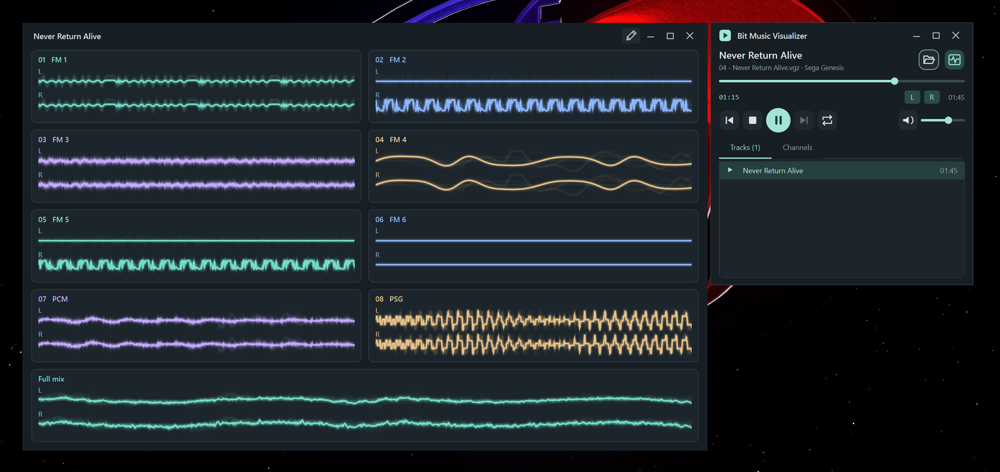

# Bit Music Visualizer

A desktop player for retro game music, with a separate window for waveforms,
spectra and piano keyboards. Listen to individual voices and explore the full mix.

[Download](https://github.com/divanikus/bitmusic-visualizer/releases/latest) · [Formats](#formats) · [ROMs](#roms-and-soundfonts) · [Shortcuts](#keyboard-shortcuts) · [Changelog](CHANGELOG.md)

## Features

- Playback, seeking, repeat and subsongs; channel mute/Solo and L/R output switches.
- Editable M3U/M3U8 playlists, shuffle and repeat for a track or the whole playlist.
- Waveform, spectrum and keyboard cards, with optional stereo display and level meters.
- MIDI piano rolls with falling notes; tracker patterns with a live playback row.
- Drag, resize and hide cards; save layouts and defaults for each sound configuration.
- Color themes, GPU glow/trails, 30/60/120 FPS targets and a CPU fallback renderer.
- Fullscreen visualization; remembered window geometry and display preferences.

## Run

Download a package from [Releases](https://github.com/divanikus/bitmusic-visualizer/releases/latest).
Extract ZIPs completely and keep their libraries, licenses and source bundle together.

| Platform | Package | Start |
| --- | --- | --- |
| Windows x64 | Portable ZIP | Run `bitmusic_visualizer.exe`; no installer or Qt SDK needed |
| Linux x64 | AppImage | `chmod +x BitMusicVisualizer-*.AppImage`, then run it |
| macOS Apple Silicon | ZIP | Open `BitMusicVisualizer.app` |

**Linux and macOS are experimental.** Linux needs glibc 2.35+ and X11/XWayland;
use `--appimage-extract-and-run` if FUSE is unavailable. macOS builds are not
notarized. See [platform requirements](docs/BUILDING.md).

1. Open music with **Ctrl+O** or drag it onto the player.
2. **Tracks** is the playlist, including subsongs inside each file. Use **+ / −**
   to add/remove, drag to reorder and **⋯** to open/save M3U8.
   **Channels** controls sound;
   **Shift-click** a visualization card or channel button to Solo it, and again
   to restore previous mutes.
3. The visualization button toggles its window. Closing that window keeps music playing.
4. Click its **pencil** to edit cards, colors, presets and display options.

## Formats

| System | Files | Cards |
| --- | --- | --- |
| NES / Famicom | NSF, NSFE | Base voices and supported expansion audio |
| Mega Drive / Genesis | VGM, VGZ | FM, DAC and a combined PSG group |
| Master System | VGM, VGZ | PSG and YM2413 FM; percussion shares FM 7–9 |
| SNES | SPC | Eight DSP voices |
| Game Boy | GBS | Two squares, wave and noise |
| ZX Spectrum | AY (ZXAYEMUL) | AY A/B/C and beeper |
| Commodore 64 | SID (PSID / RSID) | Three voices per SID; up to three chips |
| Atari 400/800 / 5200 | VGM, VGZ | Four voices from one POKEY |
| Atari 2600 | TTT (TIATracker) | Two mono TIA voices; no ROM needed |
| Yamaha FM/sample systems | VGM, VGZ | FM, PSG and sample voices; supported dual/mixed Yamaha configurations |
| General MIDI | MID, MIDI (SMF 0/1) + SF2 | Sixteen MIDI channels; unused cards start hidden |
| Roland MT-32 / CM-32L | MID, MIDI (SMF 0/1) + ROMs | Eight melodic parts and rhythm; unused cards start hidden |
| Amiga trackers | MOD (15/31 samples), MED / OctaMED, DBM | Individual tracker channels, current sample names and stereo |
| PC trackers | XM, S3M, IT, multichannel MOD | Individual tracker channels; background voices stay with their parent channel |

Additional Yamaha chips: **YM2203, YM2151, YM2608, YM2610/2610B, YM3526,
YM3812, Y8950 and YMF262**. VGM support depends on its chips; unsupported
combinations are reported. MDX, SAP, PT3, VTX and YM are not supported yet.
Other native libxmp formats can be opened through **All files**; Amiga names such
as `mod.song` work too. [Tracker details and limits](docs/TRACKERS.md).

Voice cards show signals before shared processing; **Full mix** includes effects,
volume and mutes. Tracks with no known end play until stopped, unless you enable
a limit in **Settings → Playback**. MIDI tracks
within one file play together as one song. [Format details and limits](#documentation).

## Settings

The gear in the player title bar opens a separate window with three tabs:

| Tab | Options |
| --- | --- |
| Playback | Optional limit for tracks without a known end; off by default. Applies to the next track |
| Rendering | Renderer (after restart) and 30/60/120 FPS (immediately) |
| Resources | ROM/SoundFont presence, locations, Refresh and Open folder |

Changes are saved automatically. Themes, card layout and effects remain in the
visualization editor. [Playback boundaries and limits](docs/PLAYLISTS.md#track-end-and-duration).

## ROMs and SoundFonts

Music, ROMs and SoundFonts are not bundled or downloaded. Most formats need no
extra files. A missing-ROM warning appears only when the loaded track needs it.
**Settings → Resources** shows file presence, expected locations and an Open folder
button. Presence/size checks do not certify ROM contents; the decoder validates
resources when opening music.

Folders below are relative to this **data directory**:

| Platform | Data directory |
| --- | --- |
| Windows | Folder containing `bitmusic_visualizer.exe` |
| Linux | `$XDG_DATA_HOME/BitMusicVisualizer/` (default `~/.local/share/BitMusicVisualizer/`) |
| macOS | `~/Library/Application Support/BitMusicVisualizer/` |

### ROM files

Use the exact filenames, including case. These **SHA-1** hashes identify
recommended reference dumps; other compatible revisions can also work.

| Reference image | Filename | Folder | Bytes | SHA-1 |
| --- | --- | --- | ---: | --- |
| MT-32 Control v1.07 | `MT32_CONTROL.ROM` | `roms/mt32/` | 65536 | `b083518fffb7f66b03c23b7eb4f868e62dc5a987` |
| MT-32 PCM | `MT32_PCM.ROM` | `roms/mt32/` | 524288 | `f6b1eebc4b2d200ec6d3d21d51325d5b48c60252` |
| CM-32L Control v1.02 (alternative) | `MT32_CONTROL.ROM` | `roms/mt32/` | 65536 | `a439fbb390da38cada95a7cbb1d6ca199cd66ef8` |
| CM-32L PCM (alternative) | `MT32_PCM.ROM` | `roms/mt32/` | 1048576 | `289cc298ad532b702461bfc738009d9ebe8025ea` |
| C64 KERNAL rev. 3 (901227-03) | `kernal.rom` | `roms/c64/` | 8192 | `1d503e56df85a62fee696e7618dc5b4e781df1bb` |
| C64 BASIC (901226-01) | `basic.rom` | `roms/c64/` | 8192 | `79015323128650c742a3694c9429aa91f355905e` |
| C64 character generator (901225-01) | `chargen.rom` | `roms/c64/` | 4096 | `adc7c31e18c7c7413d54802ef2f4193da14711aa` |
| YM2608 rhythm | `ym2608_adpcm_rom.bin` | `roms/ymfm/` | 8192 | `50b6c3e288eaa12ad275d4f323267bb72b0445df` |

- **MT-32:** install one matching Control/PCM pair. CM-32L uses the same filenames;
  do not mix the models or use split dumps. **Auto** detects MT-32 SysEx;
  select **MT-32** manually for arrangements without it.
- **C64:** ROMs are optional for ordinary PSID and self-contained RSID tunes.
- **YM2608:** the ROM is needed only for rhythm samples; FM/SSG and embedded VGM samples work without it.

After adding a ROM, reopen the track. Munt validates known hashes and pair
compatibility; C64/YM2608 loading checks size, not these reference hashes.
Hash sources: [Munt](https://github.com/munt/munt/blob/master/mt32emu/src/ROMInfo.cpp),
[MAME C64](https://github.com/mamedev/mame/blob/master/src/mame/commodore/c64.cpp),
[MAME YM2608](https://github.com/mamedev/mame/blob/master/src/devices/sound/ymopn.cpp).

Check a file with `Get-FileHash <file> -Algorithm SHA1` (PowerShell),
`sha1sum <file>` (Linux), or `shasum -a 1 <file>` (macOS).

### General MIDI SoundFonts

Put an **SF2** bank in `soundfonts/` under the data directory, then select it in
the player's MIDI row. The folder button opens the resource directory;
**Refresh** updates the bank list. The selected bank is remembered.
Any supported SF2 bank can be used, so there is no single recommended checksum.
SF3 and DLS are not supported. [MIDI setup and limits](docs/MIDI.md).

## Visualization controls

| Task | Control |
| --- | --- |
| Arrange cards | Pencil → drag cards; drag their edges/corners to resize |
| Change or add a view | **Cards → View** or **Add card…**; MIDI also offers **Piano roll**, trackers offer **Pattern** |
| Show the output mix | Enable **Full mix** in Cards; hidden by default |
| Show stereo or level meters | **Stereo** / **Levels** in the editor toolbar |
| Adjust waves and effects | **Display → Waves… / Effects…** |
| Set renderer or FPS | Main player gear → **Settings → Rendering** |
| Save colors | **Display → Color theme / Save theme…** |
| Save a layout / set its default | **Layout → Preset / Save preset… / Use by default**; **Clear default** removes the assignment |
| Set exact window dimensions | Window-size icon beside the background eyedropper |
| Go fullscreen | **F11** or double-click outside edit mode; **Esc** to exit |

Themes store colors; presets store the grid, cards, views, visibility and stereo
display. **Keep grid** preserves only rows/columns when no default preset applies.
**Layout** contains the grid and label options. **Done** closes the editor;
changes apply live, while saving a preset or theme remains explicit.
[Full visualization guide](docs/VISUALIZATION.md).

## Keyboard shortcuts

Press **F1** or click the keyboard icon in the main player for the in-app guide.

| Key | Action |
| --- | --- |
| 1–9 | Cycle a channel's available views, including Piano roll / Pattern |
| Ctrl+1–9 | Mute / unmute a channel |
| Ctrl+Shift+1–9 | Solo / restore previous mutes |
| Alt+1–9 | Hide / show a channel's cards |
| 0 / Alt+0 | Full mix: cycle view / hide or show |
| Ctrl+← / Ctrl+→ | Toggle left / right audio output |
| F2 / F3 / F4 | Set all cards to Waveform / Spectrum / Keyboard |
| F5 | Play from the beginning |
| F7 / F8 | Resume / pause |
| F11 / Esc | Toggle fullscreen / exit fullscreen |
| Ctrl+Shift+R | Reset cards/layout and enable all voices and L/R outputs |

Shortcuts work in either window; digits use original channel numbers and also
work on the numpad with Num Lock. On macOS, use **Command** for Ctrl and **Option**
for Alt. Text fields, dropdowns and dialogs keep their normal keys.

## Settings and diagnostics

| Platform | Settings file |
| --- | --- |
| Windows | `BitMusicVisualizer.ini` beside the EXE |
| Linux | `$XDG_CONFIG_HOME/BitMusicVisualizer/BitMusicVisualizer.ini` (default under `~/.config/`) |
| macOS | `~/Library/Preferences/org.bitmusicvisualizer.BitMusicVisualizer.plist` |

Themes and presets use `themes/` and `presets/` in the [data directory](#roms-and-soundfonts).
`--software-scopes` selects CPU rendering for one launch. `--diagnostics` writes
local logs; review paths and device details before sharing. No telemetry or automatic uploads.

## Libraries

| Library | Used for | License |
| --- | --- | --- |
| [Qt 6](https://www.qt.io/development/qt-framework) | Interface, audio output and GPU rendering | LGPL-3.0 (selected modules) |
| [Game Music Emu](https://github.com/libgme/game-music-emu) | Console/chiptune playback and sound-chip emulation | LGPL-2.1-or-later |
| [libsidplayfp / reSIDfp](https://github.com/libsidplayfp/libsidplayfp) | Commodore 64 and SID emulation | GPL-2.0-or-later |
| [ymfm](https://github.com/aaronsgiles/ymfm) | Yamaha FM, PSG and sample-chip emulation | BSD-3-Clause |
| [FluidSynth](https://github.com/FluidSynth/fluidsynth) | General MIDI synthesis with SoundFonts | LGPL-2.1-or-later |
| [Munt / libmt32emu](https://github.com/munt/munt) | Roland MT-32 and CM-32L emulation | LGPL-2.1-or-later |
| [libxmp](https://github.com/libxmp/libxmp) | Amiga and PC tracker playback, channel mixing | MIT |
| [TIATracker / bundled Stella core](https://bitbucket.org/kylearan/tiatracker) | Atari 2600 TTT sequencing and TIA audio | GPL-2.0-or-later |
| [zlib](https://github.com/madler/zlib) | Gzip/VGZ decompression | zlib |

For pinned versions, local modifications and supporting build/runtime dependencies,
see [third-party components and licenses](THIRD-PARTY.md).

## Documentation

[Playlists](docs/PLAYLISTS.md) · [Visualization](docs/VISUALIZATION.md) · [SID](docs/SID.md) · [VGM chips](docs/VGM.md) · [TIATracker](docs/TIATRACKER.md) · [General MIDI](docs/MIDI.md) · [MT-32](docs/MT32.md) · [Build and test](docs/BUILDING.md)

## License

Original application code and artwork are [MIT](LICENSE). The combined
SID-enabled application is **GPLv3** ([COPYING](COPYING)); dependencies retain
their own licenses. Release packages include corresponding source and notices.
See [third-party components and licenses](THIRD-PARTY.md).
